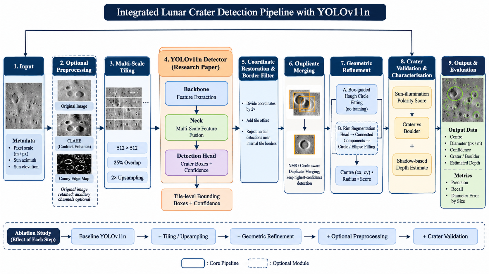
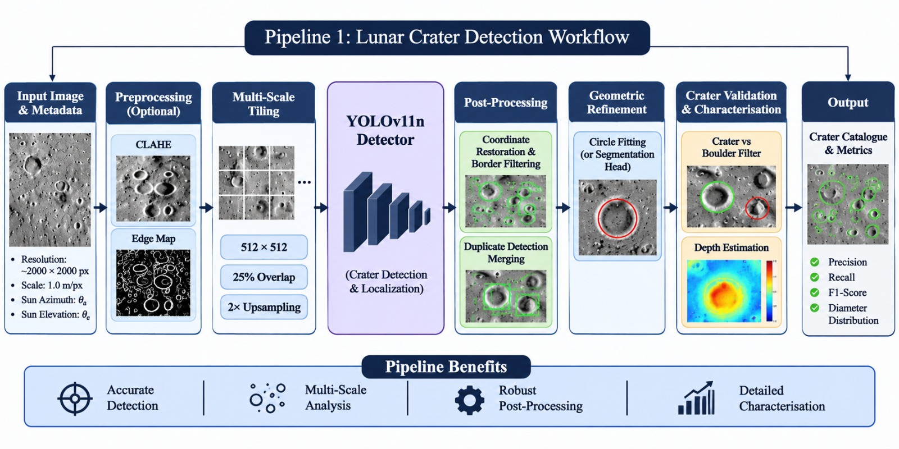
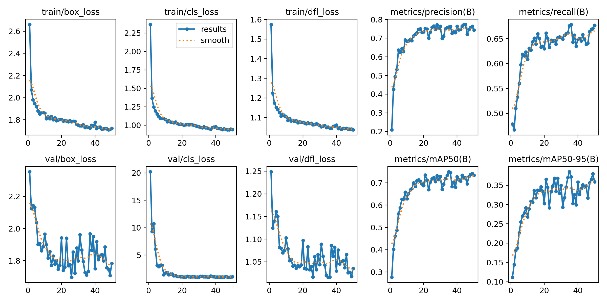
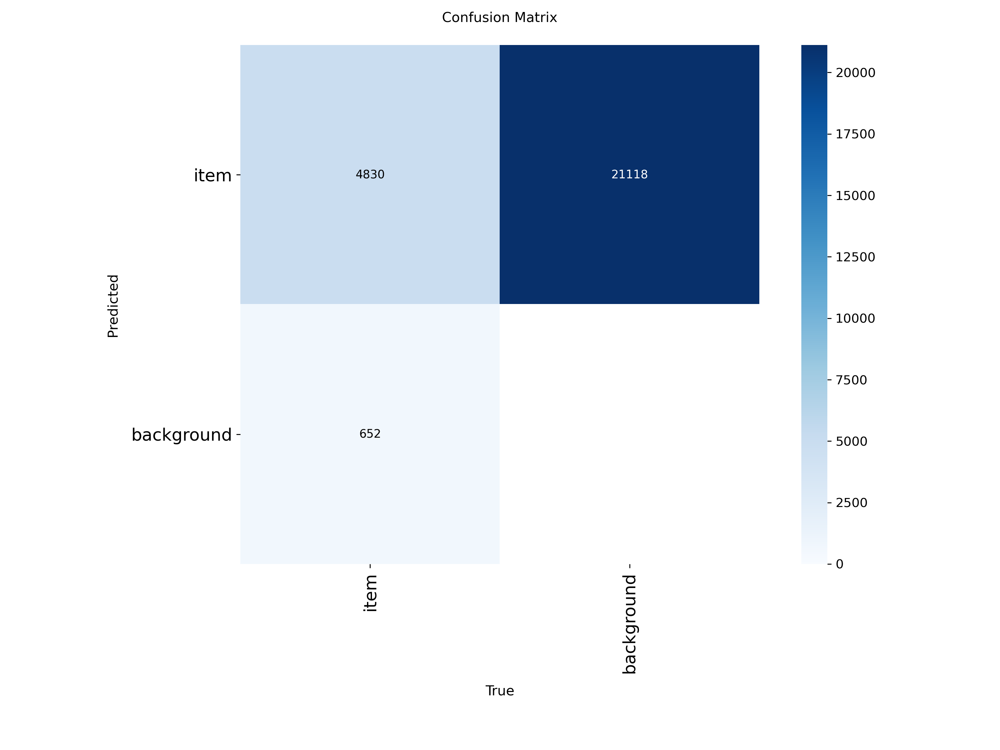

# Lunar Crater Detection

A reproducible research project for detecting lunar impact craters in Lunar Reconnaissance Orbiter Narrow Angle Camera (LRO NAC) imagery. The repository brings together the SomBench NAC training and evaluation notebook, image inference, a GeoTIFF-aware workflow, architecture diagrams, selected run artifacts, and a trained baseline checkpoint.

> **Status:** research prototype. Review the data and evaluation notes before interpreting results or applying the model to new imagery.

## Project at a glance

- **Detector:** Ultralytics YOLO11n, fine-tuned for one crater class.
- **Training data:** `nasa-ibm-ai4science/Sombench-NAC-Crater-Detection` (Hugging Face dataset repository; see [data notes](docs/data-and-evaluation.md)).
- **Input preparation:** 256 px training tiles are contrast-stretched using the 2nd and 98th percentiles of valid pixels; inference uses matching preprocessing.
- **Inference:** tiled image prediction with coordinate remapping and duplicate suppression; a separate notebook handles TIFF/GeoTIFF and additional raster formats.
- **Primary held-out test summary:** 46 images, 678 true positives, 58 false positives, and 903 false negatives at confidence 0.55 using the crater-specific matching rule described in the results files. Precision 0.921, recall 0.429, F1 0.585. These are project-reported results; see limitations and protocol details before comparing them with other work.

## Repository map

```text
notebooks/   Training/evaluation, general image inference, GeoTIFF inference
figures/     Pipeline diagrams and selected training/evaluation visuals
results/     Compact metrics, reproducibility metadata, and training configuration
weights/     Trained baseline checkpoint (best.pt)
docs/        Pipeline guide and data/evaluation notes
```

## Start here

1. Read [data and evaluation notes](docs/data-and-evaluation.md) and [GeoTIFF notes](docs/geotiff-workflow.md).
2. Open `notebooks/train-and-evaluate.ipynb` in Kaggle or a compatible Jupyter environment. The notebook downloads the dataset and initializes from public `yolo11n.pt` weights; GPU execution is recommended.
3. For ordinary image inference, use `notebooks/image-inference.ipynb` and attach the checkpoint as a Kaggle input.
4. For TIFF/GeoTIFF and supported scientific raster inputs, use `notebooks/geotiff-inference.ipynb`.

The notebooks contain environment-specific paths and install cells. Review the configuration cells before running in a different environment. Never treat the example checkpoint as a substitute for validation on the target instrument, illumination, resolution, and region.

## Architecture

| Workflow | Diagram |
|---|---|
| Integrated detector pipeline |  |
| Tiled detection flow |  |
| GeoTIFF-aware workflow |  |

## Selected results

The repository keeps compact, traceable outputs instead of the full 220 MB `all_outputs.zip`. See `results/test_summary.csv`, `results/test_size_bin_recall.csv`, and `results/reproducibility.json` for metric definitions and run configuration. The baseline-vs-fine-tuned CSV is a **validation** comparison and must not be confused with the held-out test result.





## Limitations

- Recall on the reported held-out split is substantially lower than precision; missed craters remain a key limitation.
- Evaluation uses a crater-specific one-to-one centre/diameter matching rule, not standard object-detection mAP. Metrics from different protocols are not directly comparable.
- Small craters below 10 m are ignored under the reported evaluation policy.
- The benchmark has limited illumination diversity and does not establish generalization across all lunar imaging conditions.
- Tiled inference can be computationally expensive. Changing tile size can change detections; benchmark any change instead of assuming equivalent results.
- GeoTIFF support reads raster bands and metadata through Rasterio. Inspect the notebook's per-file errors and exported metadata for each run; support for a format does not guarantee scientific suitability of every file.

## Figures and publication use

The included training plots and sample predictions are original run artifacts. For publication, regenerate plot exports at **200 dpi or higher**, use readable labels, and cite the underlying run. Do not upscale raster screenshots and describe them as high-resolution plots. Architecture diagrams may be reused as project schematics with a clear caption.

## Data, model, and licensing

The raw SomBench dataset and its image cache are not included. Obtain it from the dataset source and follow its terms. The trained checkpoint is provided as `weights/best.pt`; check the applicable Ultralytics and pretrained-weight terms before redistribution or deployment. No blanket license is asserted for third-party data or model components.

## Citation

Please cite the SomBench dataset and the relevant lunar crater-detection literature when reusing this work. Add the final paper citation here once the manuscript is accepted or published. See the highlighted reference paper supplied with the project for the initial related-work lead; it is not redistributed in this repository.

